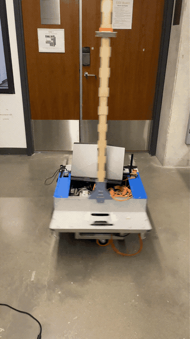

 
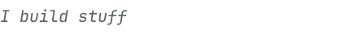 
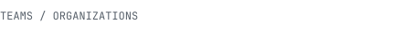 
<a href="https://hijaz.dev/experience/robotathon-2025/">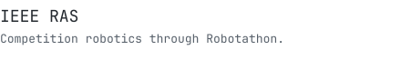</a> 
<a href="https://hijaz.dev/experience/eclair-makeathon-2025/">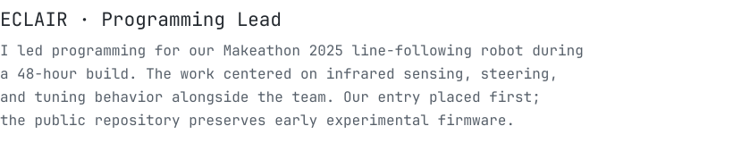</a> 
<a href="https://hijaz.dev/experience/igvc-2027/">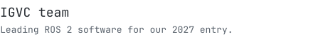</a> 

 

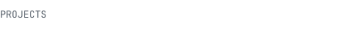 
<a href="https://github.com/moneerhijaz/robotathon-2025">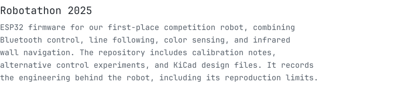</a> 
<a href="https://github.com/moneerhijaz/media-manager">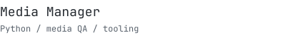</a> 
<a href="https://github.com/moneerhijaz/autonav-rover-drone">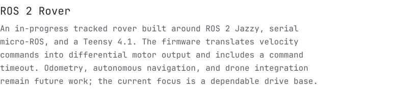</a> 
<a href="https://github.com/moneerhijaz/jarvis">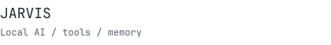</a> 

<a href="https://hijaz.dev/">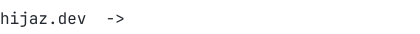</a>
